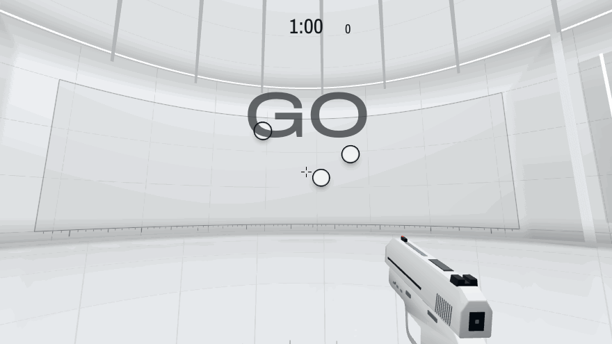
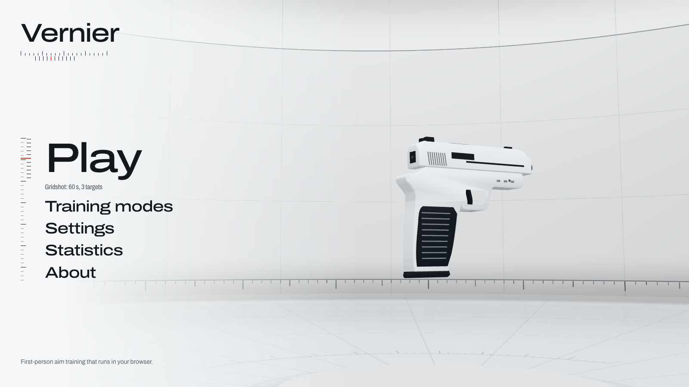
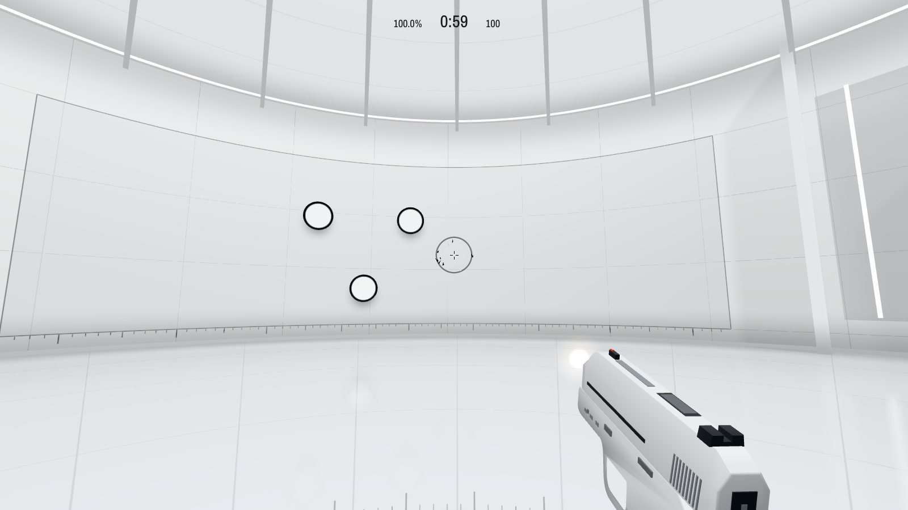
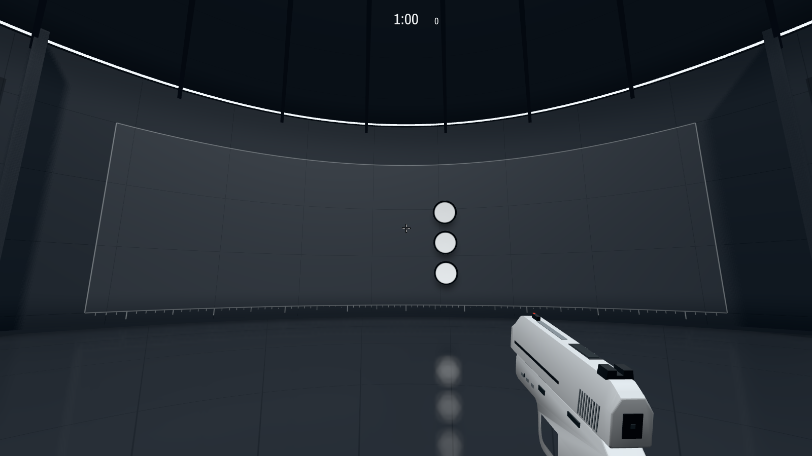
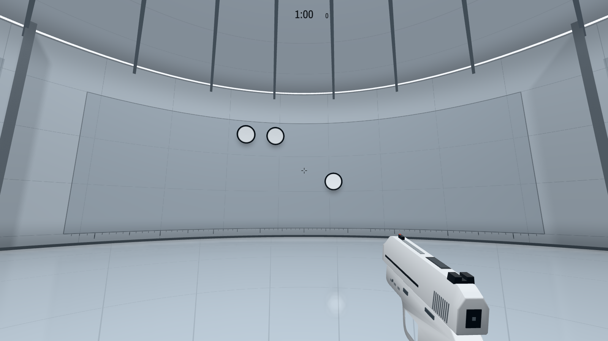
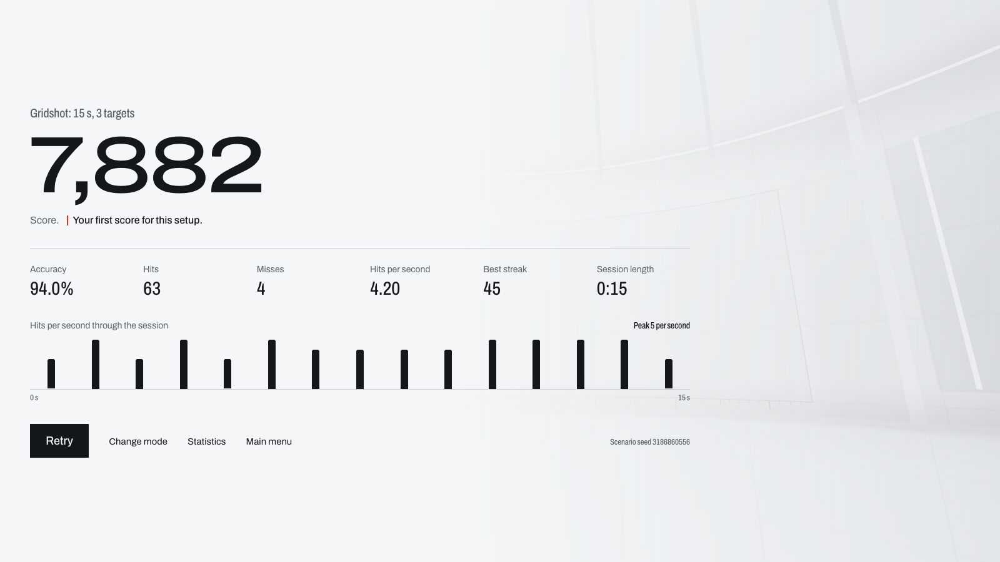
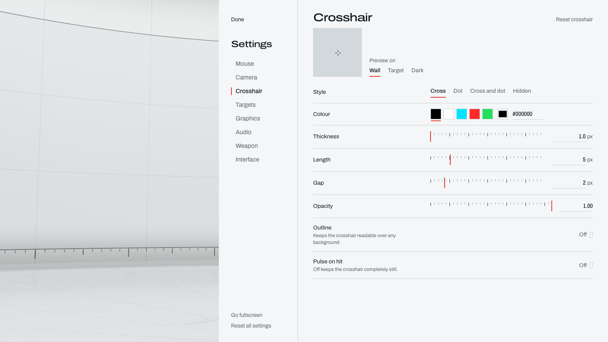

# Vernier

A first-person 3D aim trainer that runs in the browser. There's nothing to install and no account to create.

**[Play it in your browser](https://vernier-beta.vercel.app)** on a desktop or laptop with a mouse.

You stand at the exact centre of a white circular chamber with a ceramic pistol and a tiny black crosshair, and shoot targets across six training modes. Mouse input goes straight to the camera, shots resolve inside the click, and the room draws in a few milliseconds a frame.



| | |
|---|---|
|  |  |
|  |  |
|  |  |

> The demo is the real game played by a script, with time stepped by hand so each frame could be captured. See [`scripts/capture-demo.mjs`](scripts/capture-demo.mjs).

## Run it locally

Requires Node 20.19 or later.

```bash
git clone https://github.com/yoonmax/vernier.git
cd vernier
npm install
npm run dev
```

Then open http://localhost:5173. For the best input path, use a current version of Chrome or Edge.

## Features

**Six training modes**

| Mode | Rules | Measured by |
|---|---|---|
| Gridshot | 3 to 5 targets on a grid, replaced on hit. 15, 30, 60 or 120 s | Score |
| Precision | One target at a time, with no clock | Hits per second |
| Speed | Hit 25, 50 or 100 targets as fast as possible | Completion time |
| Micro | Targets as small as 0.55°, timed or endless | Score, or hits per second if endless |
| Tracking | Horizontal, vertical, circular or random motion, in click or hold-to-track variants | Score, or time on target when holding |
| Reaction | Wait for the target, then shoot it. False starts are penalised | Median time plus penalties |

**Settings for everything that matters to aim**

- Sensitivity, by slider or exact value, with degrees per count and estimated cm/360
- Vertical multiplier, invert Y and raw input, with a readout of whether raw input is really active
- Horizontal FOV from 60 to 120°
- Crosshair editor with a live preview: style, colour, thickness, length, gap, dot, opacity and outline
- Target colour, size, spawn area, border and opacity, plus a scenario seed to replay a sequence

Runs with customised difficulty still count towards training totals, but can't set personal bests.

**Graphics and audio**

- Three themes: White lab, Dark studio and Soft chrome. Themes never affect gameplay
- Four quality presets, with each setting also adjustable by hand
- FPS caps from 60 to 360, or uncapped
- FPS overlay with current, average and 1% low
- Every sound is synthesised at startup, with a separate volume for each kind

**Statistics**

Totals, per-mode figures, personal bests for each variant, and recent history, all saved in your browser. Everything comes from recorded gameplay events, and nothing is uploaded.

## Technology

JavaScript (ES modules), [Three.js](https://threejs.org) and WebGL for the game, React and Tailwind CSS for the interface, GSAP for menu motion, Zustand for state, the Web Audio API, the Pointer Lock API, Vite, Vitest and Playwright.

## Architecture

The simulation has no dependency on rendering, so every rule can run and be tested without a browser. Data flows one way: input changes the simulation, the simulation is read by the renderer, and React only ever draws menus.

```
src/
  core/       Game (wiring), GameLoop, GameStateMachine, TimeManager, FrameStats
  input/      MouseInput, PointerLockManager, SensitivityController
  shooting/   ShootingSystem, RaycastManager, HitEffects
  targets/    Target, TargetPool, TargetManager, TargetSpawner, TargetMotion
  modes/      GameMode (shared rules), one small class per mode, modeCatalog
  stats/      SessionRecorder, StatisticsManager, metrics
  settings/   SettingsSchema (defaults and validation), SettingsStorage, settingsStore
  rendering/  Renderer, CameraController, Arena, Lighting, WeaponViewModel, PistolModel,
              TargetVisuals, PlanarReflection, surfaceMaterial, themes
  audio/      AudioManager, synth
  ui/         Screens and controls. HUD.jsx is driven directly, outside React's render cycle
```

**Modes** describe their rules (target count, size, region, duration or goal) and override a few hooks where they truly differ. Spawning, timing and scoring live once, in `GameMode`. Adding a mode means one small class and one catalogue entry.

**React is never involved in play.** During a session no component re-renders per frame or per shot. The game calls methods on the HUD, and each writes straight to the DOM node it owns, only when its text has changed.

## The input path

Input is the most important system here, so it's kept short.

1. **Pointer Lock** is requested with `unadjustedMovement: true`, which bypasses OS acceleration where supported. If refused, the game falls back to a standard lock and says so in the settings.
2. **Events are handled as they arrive.** `pointerrawupdate` is used where available, because it delivers movement as it happens rather than coalescing it into one event per frame, with `mousemove` as the fallback.
3. **Rotation is applied inside the event handler**, not queued for the next frame:

   ```
   yaw   -= counts_x × sensitivity × 0.022° (in radians)
   pitch -= counts_y × sensitivity × 0.022° × vertical multiplier (clamped)
   ```

   Sensitivity is a pure angle-per-count ratio with **no delta time in it**. Mouse counts are already a distance, so scaling them by frame time would make your aim depend on your frame rate. A test confirms that one 600-count move and 120 five-count moves produce the same rotation.

4. **The default path is direct.** No smoothing, no easing, no inertia. Recoil and idle movement only touch the pistol model, which has its own scene and camera and can't affect where you aim.
5. **Shots are timed from the click itself**, using the event's own timestamp, so a busy moment in the browser can't add to a measured time.
6. **Feedback appears on the next frame.** Animations read the current time rather than the frame's timestamp, which is usually earlier than input handled just before the frame and would hold a shot's feedback back by a whole frame.

## Shooting

A shot is hitscan, resolved inside the `mousedown` handler (0.4 ms in the median case), so the result exists before the handler returns. There's no spread, travel time or dependency on animation. The ray starts at the eye and points along the authoritative view direction:

```
D = ( -sin(yaw) · cos(pitch),  sin(pitch),  -cos(yaw) · cos(pitch) )
```

Each target is a disc with centre `C`, radius `r` and normal `N`, always facing the eye. The ray meets its plane at:

```
t = dot(C - O, N) / dot(D, N)
```

and hits if `t > 0` and `|O + tD - C| ≤ r`. This is exact, with no physics engine and no scene traversal.

**Hit area matches what you see.** The disc's widest ring lies in the plane used by the test, and the disc always faces the fixed eye, so the visible silhouette and the hit circle are the same circle. There's no invisible margin. A test checks the boundary at 24 points around a target.

**Moving targets** are tested at the position last drawn, so what you see is what you hit.

## Target placement

**Why the room is round.** Targets sit on a sphere centred on the eye, so all of them are 16 m away. Size can then be defined as a true angle:

```
r = 16 · tan(diameter / 2)
```

A 3° target is 3° wherever it spawns. On a flat wall, a target at the side would be further away and look smaller, so a score would partly depend on where the targets happened to appear. The circular room makes that impossible, and it's why the room is the shape it is.

The spawner works in angles within a forward region. That guarantees each target is in front of the player, in front of the wall, and reachable. It then:

- Tries up to 32 random candidates that clear the other targets by a minimum gap, and aren't too close to the previous spawn
- Never overlaps the target you just hit, because a new disc on the same spot would look as if the shot did nothing
- Uses the least-bad candidate if a crowded region has no perfect position
- Keeps every disc above the floor, at any target size and spawn area. Standard runs are unaffected
- Widens the grid if large targets or a small spawn area would otherwise make cells overlap, allowing for yaw covering less visual angle higher up (it shrinks with cos(pitch))
- Takes every choice from a seeded generator, so a seed fully determines a scenario

Target objects come from a fixed pool, and all targets draw as instances of a single mesh.

Tracking motion is a pure function of session time rather than an integrated velocity. Sampling it at 60 Hz or 360 Hz gives the same path, so target speed can't depend on frame rate.

## Timing and focus

The session clock is monotonic and excludes paused time. Losing pointer lock, losing window focus or hiding the tab all pause the session immediately, and timed modes can't run down in the background. Timed sessions report their exact length even if the frame that ends them arrives late.

## Performance decisions

| Decision | Why |
|---|---|
| Direct-to-screen by default | No intermediate full-screen passes between the game and the display. Post-processing only runs if you turn on something that needs it |
| Seams and ambient occlusion computed in the shader from world position | Lines stay sharp at any resolution, with analytic anti-aliasing and no texture memory. The AO is the room's known geometry written as a function, for a few instructions per pixel |
| Room shadows render once | Only static geometry casts into the shadow map, so it never re-renders during play. Targets use cheap contact shadows |
| Environment captured once | The room is rendered into a pre-filtered map at load, so glossy surfaces reflect this exact room at no per-frame cost |
| Hit effects run on the GPU | A burst writes start values once, and the vertex shader computes each fragment from elapsed time. No per-particle CPU work and no allocation |
| Instancing for repeated parts | One frame is 25 draw calls, or 41 with the floor reflection |
| Pools and reused result objects | Rapid shooting creates very little garbage |
| Shaders compiled before play | The first shot of a session can't hitch on a shader compile |
| Targets drawn last | The pistol can't hide a target, and targets draw only once per frame |
| Reflection skipped when no floor is in view | It's the most expensive optional pass, so it only runs when it can be seen |
| Sounds made in spare moments after loading | Synthesising them all at once would add about 40 ms to the first click |
| HUD isolated with CSS containment | Changing a readout can't invalidate the rest of the page |

### Measured

From `npm run measure`, which plays a 6-second Gridshot session with display frame limiting removed, shooting 10 times a second:

| Preset | Resolution | Average FPS | Frame time | Draw calls |
|---|---|---|---|---|
| Performance | 1920×1080 | 825 | 1.21 ms | 25 |
| Balanced | 1920×1080 | 833 | 1.20 ms | 26 |
| High (default) | 1920×1080 | 780 | 1.28 ms | 41 |
| High (default) | 3840×2160 (2× display) | 285 | 3.50 ms | 41 |
| Ultra | 1920×1080 | 131 | 7.65 ms | 73 |

Measured on an Apple M4 Pro, in headless Chromium using Metal, with vsync off. Your hardware will differ, and a real session is limited by your display.

- **Ultra isn't for competitive practice.** At about 131 FPS here, it can't keep up with a 144 Hz or faster display. Use High or lower.
- **1% lows aren't listed** because they aren't repeatable with vsync off: Performance's ranged from 67 to 193 across runs, and Ultra's stayed near 12. With vsync on at 60 Hz, High and Ultra both ran 10-second sessions with no frame over 16.8 ms, and frames just after a shot took no longer than others. That says nothing yet about a 240 Hz display, which hasn't been tested.

Costs in the page at High with vsync on, over a 10-second session of 10 shots a second, during which all 99 shots showed on the very next frame:

| Work | Time |
|---|---|
| Applying one mouse movement | under 0.001 ms |
| Handling one shot, including hit detection, sound and HUD | 0.4 ms median, 1.7 ms worst |
| JavaScript per rendered frame | 1.6 ms median, 2.6 ms worst |

## Tests

```bash
npm test                # 272 unit tests
npm run test:e2e        # 76 browser tests, in Chromium with real Pointer Lock
npm run test:browsers   # smoke tests in Firefox and WebKit
```

The browser tests use the production build. Several read back real pixels from the screen:

- **What you see is what you hit.** Finds the edges of a rendered disc, then fires the real shooting system through the pixels around them, at several FOVs and window shapes. Hit detection and the picture agree to within one pixel.
- **The crosshair** is solid whole pixels at 1×, 1.25×, 1.5× and 2×, and within half a pixel of the camera's centre on even and odd window sizes.
- **The pistol can't hide a target**, and the room and pistol stay on screen while targets are up.

Others cover exact turn rate from real mouse events at different frame caps, 500 clicks inside one frame, shot feedback on the very next frame, recoil leaving the aim untouched, every mode's scoring and timing, pause and focus loss, settings persistence, corrupted saves, lost graphics contexts and missing WebGL.

### What needs a person and a real mouse

Automated tests can't feel aim. They also use synthetic input, so none of these have been checked yet:

1. **Aim feel.** Does tracking a target feel direct, with no float or smoothing?
2. **True sensitivity.** Do a slow 360° turn against a ruler and compare it to the estimated cm/360, at 100% browser zoom and on a scaled display. Browsers can differ in how they scale movement.
3. **End-to-end latency.** It hasn't been measured. It needs a high-speed camera or a tool such as NVIDIA Reflex Analyzer.
4. **A high-refresh display.** Turn on the FPS overlay in Interface settings on a 144 Hz or 240 Hz display, and check that it holds that rate and the 1% low stays close.
5. **A high-polling mouse.** Try 1000 Hz and above, watching for any jumps in the view during fast flicks.
6. **Pressing Esc, then Resume.** Tests can only end the lock from code, and browsers treat the real Esc key differently. Resume should work on the first click, however quickly you press it.
7. **Safari.** Headless WebKit can't take Pointer Lock, so real play in Safari is untested.
8. **Windows and Linux.** All measurements so far come from one Mac.
9. **Weaker hardware.** The default High preset hasn't been tried on integrated graphics. Performance is there if it struggles.

## Deploy

Vernier is a static site with no server component.

```bash
npm run build
```

Upload the `dist` folder to any static host. On Vercel, import the repository and accept the detected Vite settings, or run:

```bash
npx vercel --prod
```

## Known limitations

**Imposed by browsers, not the game**

- **Frame rate can't exceed your display's refresh rate.** Browsers pace `requestAnimationFrame` to the display, so "Uncapped" means the game adds no limit of its own.
- **Browser input isn't identical to native input.** The event path through the browser and compositor adds latency that a native game can avoid.
- **Raw input isn't universal.** `unadjustedMovement` depends on browser and OS, and Firefox doesn't offer it. Where it's unavailable, your OS pointer settings apply. Check the Mouse settings for what your browser is actually doing.
- **Browsers delay re-locking for about a second after Esc.** Vernier keeps retrying from your click, so Resume can take up to a second or so to take effect.
- **The first click after opening a browser can take about 0.1 s** while it starts its audio engine (118 ms measured, then 2 ms on later pages). Browsers don't allow audio to start before a click. It happens on a menu or Ready click, never during a session.
- **Low-latency canvases aren't used.** Chromium ignored the `desynchronized` hint on the Mac this was tested on, so it couldn't be verified and isn't enabled.
- **Reaction times include hardware latency** from your mouse, system and display. They're for comparing your own sessions, not laboratory measurements.

**Choices in this project**

- **Cm/360 is an estimate.** It assumes your mouse really reports the DPI you enter and that nothing rescales it.
- **Mouse only.** Touch devices get an explanation rather than a touch mode that wouldn't train the same skill.
- **Statistics stay in one browser.** There's no sync or export, and clearing site data removes them.
- **Sensitivity follows the 0.022° per count convention** used by several shooters, so a familiar number gives a familiar turn rate in those games. Others use different scales.
